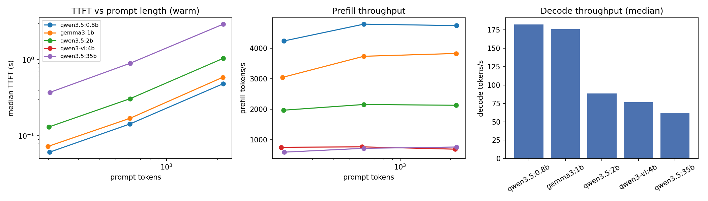
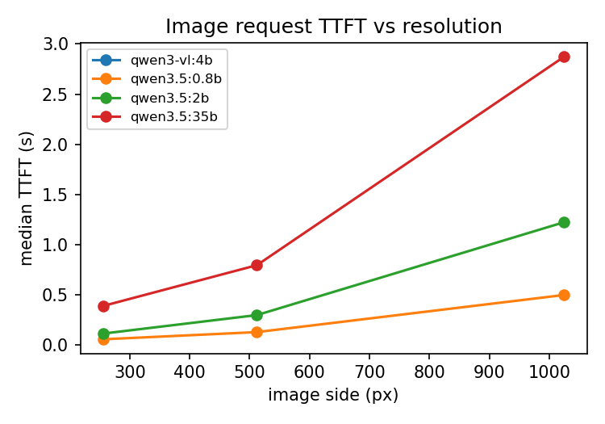
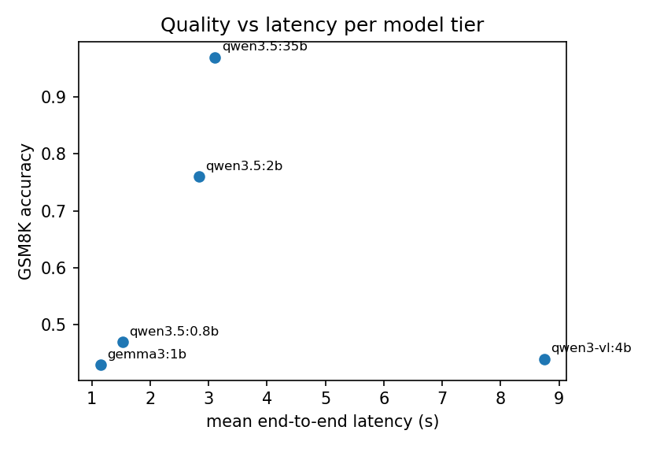
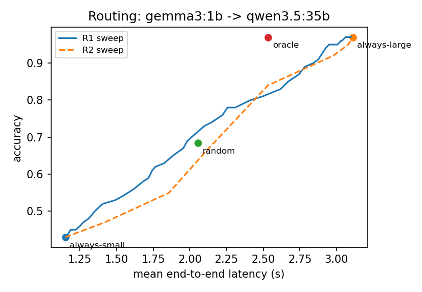
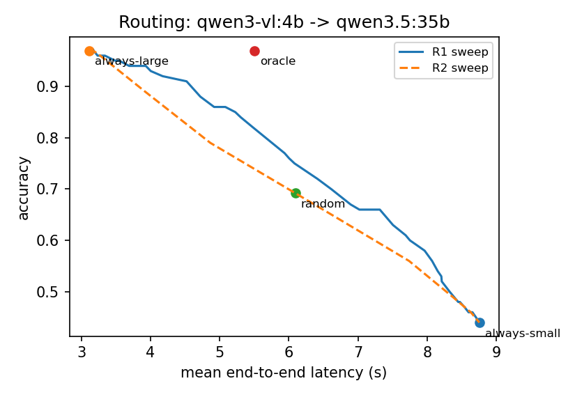
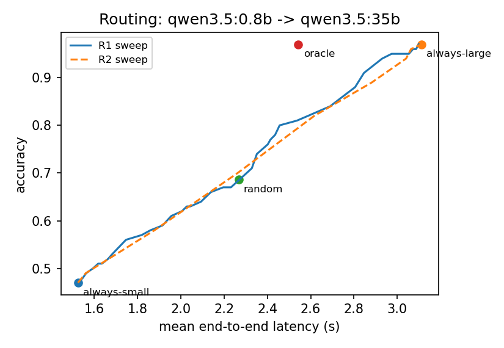
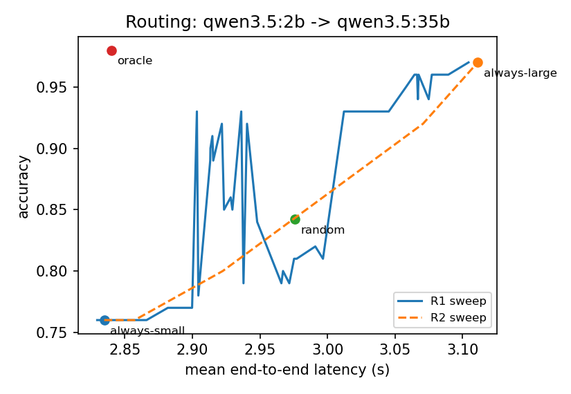
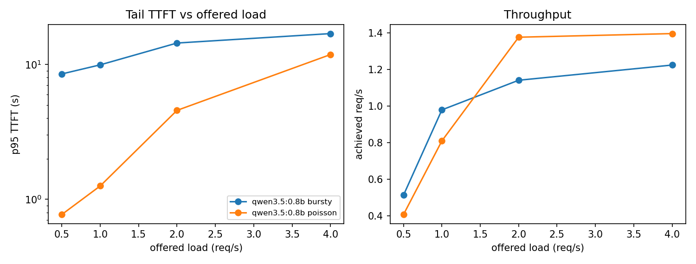

# Phase 1 results

Generated by `harness/analyze.py` from `results/raw/`. Host: Apple M4 Pro, 48 GB, Ollama 0.40.14.

## E1/E4: isolated profiles and cold start

E1: 136 requests, 0 failed or timed out.

Per model (medians over all warm text runs; load time and resident memory from cold starts):

| model | params | quant | prefill_tps | decode_tps | tpot_ms | load_s | resident_gb |
|---|---|---|---|---|---|---|---|
| qwen3.5:0.8b | 852.88M | mxfp8 | 4620.63 | 182.38 | 5.48 | 0.61 | 1.18 |
| gemma3:1b | 999.89M | Q4_K_M | 3674.24 | 176.12 | 5.68 | 0.55 | 0.89 |
| qwen3.5:2b | 2.2B | mxfp8 | 2110.14 | 88.50 | 11.30 | 0.61 | 2.92 |
| qwen3-vl:4b | 4.4B | Q4_K_M | 750.95 | 76.53 | 13.07 | 1.66 | 4.16 |
| qwen3.5:35b | 36.0B | Q4_K_M | 719.32 | 62.16 | 16.09 | 9.12 | 21.25 |

Image requests (bar-chart question with a known answer):

| model | image_px | prompt_tokens | ttft_s | prefill_s | accuracy | runs |
|---|---|---|---|---|---|---|
| qwen3-vl:4b | 256 | 1059 | nan | 2.38 | 0 | 3 |
| qwen3-vl:4b | 512 | 1058 | nan | 2.35 | 0 | 3 |
| qwen3-vl:4b | 1024 | 1058 | nan | 2.32 | 0 | 3 |
| qwen3.5:0.8b | 256 | 103 | 0.06 | 0.04 | 1 | 3 |
| qwen3.5:0.8b | 512 | 294 | 0.13 | 0.11 | 1 | 3 |
| qwen3.5:0.8b | 1024 | 1062 | 0.50 | 0.46 | 1 | 3 |
| qwen3.5:2b | 256 | 102 | 0.12 | 0.10 | 1 | 3 |
| qwen3.5:2b | 512 | 295 | 0.30 | 0.28 | 1 | 3 |
| qwen3.5:2b | 1024 | 1062 | 1.22 | 1.18 | 1 | 3 |
| qwen3.5:35b | 256 | 103 | 0.39 | 0.36 | 1 | 3 |
| qwen3.5:35b | 512 | 294 | 0.80 | 0.77 | 1 | 3 |
| qwen3.5:35b | 1024 | 1062 | 2.87 | 2.84 | 1 | 3 |

## E5: GSM8K tier labels

E5: 500 requests, 0 failed or timed out.

| model | params | quant | accuracy | mean_output_tokens | mean_e2e_s | p95_e2e_s | n |
|---|---|---|---|---|---|---|---|
| qwen3.5:0.8b | 852.88M | mxfp8 | 0.47 | 266.32 | 1.53 | 2.85 | 100 |
| gemma3:1b | 999.89M | Q4_K_M | 0.43 | 183.26 | 1.15 | 3.04 | 100 |
| qwen3.5:2b | 2.2B | mxfp8 | 0.76 | 242.94 | 2.83 | 5.87 | 100 |
| qwen3-vl:4b | 4.4B | Q4_K_M | 0.44 | 460.62 | 8.75 | 10.41 | 100 |
| qwen3.5:35b | 36.0B | Q4_K_M | 0.97 | 160.14 | 3.11 | 5.69 | 100 |

Smallest model tier that solves each problem (over 100 problems answered by every tier):

| smallest_correct_tier | problems |
|---|---|
| qwen3.5:0.8b | 47 |
| gemma3:1b | 14 |
| qwen3.5:2b | 24 |
| qwen3-vl:4b | 2 |
| qwen3.5:35b | 11 |
| none | 2 |

## Offline routing simulation: gemma3:1b -> qwen3.5:35b

| policy | accuracy | mean_latency_s | p95_latency_s | large_fraction | n |
|---|---|---|---|---|---|
| always-small | 0.430 | 1.150 | 3.036 | 0 | 100 |
| always-large | 0.970 | 3.111 | 5.694 | 1 | 100 |
| random | 0.684 | 2.056 | 4.965 | 0.472 | 100 |
| R1-length (>31 words, p25) | 0.890 | 2.784 | 5.694 | 0.730 | 100 |
| R1-length (>39 words, p50) | 0.780 | 2.257 | 5.373 | 0.490 | 100 |
| R1-length (>49 words, p75) | 0.630 | 1.826 | 4.506 | 0.240 | 100 |
| R2-logreg (tau=0.5) | 0.950 | 3.081 | 5.694 | 0.980 | 100 |
| R2-logreg (tau=0.7) | 0.970 | 3.111 | 5.694 | 1 | 100 |
| R2-logreg (tau=0.9) | 0.970 | 3.111 | 5.694 | 1 | 100 |
| oracle | 0.970 | 2.534 | 5.694 | 0.570 | 100 |

## Offline routing simulation: qwen3-vl:4b -> qwen3.5:35b

| policy | accuracy | mean_latency_s | p95_latency_s | large_fraction | n |
|---|---|---|---|---|---|
| always-small | 0.440 | 8.754 | 10.414 | 0 | 100 |
| always-large | 0.970 | 3.111 | 5.694 | 1 | 100 |
| random | 0.692 | 6.093 | 10.339 | 0.472 | 100 |
| R1-length (>31 words, p25) | 0.880 | 4.722 | 10.288 | 0.730 | 100 |
| R1-length (>39 words, p50) | 0.770 | 5.938 | 10.308 | 0.490 | 100 |
| R1-length (>49 words, p75) | 0.630 | 7.505 | 10.337 | 0.240 | 100 |
| R2-logreg (tau=0.5) | 0.960 | 3.274 | 6.058 | 0.970 | 100 |
| R2-logreg (tau=0.7) | 0.970 | 3.111 | 5.694 | 1 | 100 |
| R2-logreg (tau=0.9) | 0.970 | 3.111 | 5.694 | 1 | 100 |
| oracle | 0.970 | 5.504 | 9.217 | 0.560 | 100 |

## Offline routing simulation: qwen3.5:0.8b -> qwen3.5:35b

| policy | accuracy | mean_latency_s | p95_latency_s | large_fraction | n |
|---|---|---|---|---|---|
| always-small | 0.470 | 1.526 | 2.852 | 0 | 100 |
| always-large | 0.970 | 3.111 | 5.694 | 1 | 100 |
| random | 0.686 | 2.267 | 4.965 | 0.472 | 100 |
| R1-length (>31 words, p25) | 0.910 | 2.846 | 5.694 | 0.730 | 100 |
| R1-length (>39 words, p50) | 0.780 | 2.436 | 5.373 | 0.490 | 100 |
| R1-length (>49 words, p75) | 0.640 | 2.094 | 4.506 | 0.240 | 100 |
| R2-logreg (tau=0.5) | 0.890 | 2.882 | 5.446 | 0.850 | 100 |
| R2-logreg (tau=0.7) | 0.970 | 3.111 | 5.694 | 1 | 100 |
| R2-logreg (tau=0.9) | 0.970 | 3.111 | 5.694 | 1 | 100 |
| oracle | 0.970 | 2.543 | 5.446 | 0.530 | 100 |

## Offline routing simulation: qwen3.5:2b -> qwen3.5:35b

| policy | accuracy | mean_latency_s | p95_latency_s | large_fraction | n |
|---|---|---|---|---|---|
| always-small | 0.760 | 2.835 | 5.871 | 0 | 100 |
| always-large | 0.970 | 3.111 | 5.694 | 1 | 100 |
| random | 0.842 | 2.976 | 5.875 | 0.472 | 100 |
| R1-length (>31 words, p25) | 0.940 | 3.067 | 5.694 | 0.730 | 100 |
| R1-length (>39 words, p50) | 0.920 | 2.922 | 5.446 | 0.490 | 100 |
| R1-length (>49 words, p75) | 0.820 | 2.991 | 5.869 | 0.240 | 100 |
| R2-logreg (tau=0.5) | 0.760 | 2.835 | 5.871 | 0 | 100 |
| R2-logreg (tau=0.7) | 0.760 | 2.839 | 5.871 | 0.010 | 100 |
| R2-logreg (tau=0.9) | 0.970 | 3.111 | 5.694 | 1 | 100 |
| oracle | 0.980 | 2.840 | 5.212 | 0.240 | 100 |

## E2: load curves (open-loop arrivals)

E2: 240 requests, 0 failed or timed out.

| model | pattern | offered_rps | n | failed | achieved_rps | output_tps | p50_ttft_s | p95_ttft_s | p50_e2e_s | p95_e2e_s | median_tpot_ms | peak_concurrent_decode | cpu_util |
|---|---|---|---|---|---|---|---|---|---|---|---|---|---|
| qwen3.5:0.8b | bursty | 0.50 | 30 | 0 | 0.51 | 64.39 | 1.58 | 8.51 | 2.01 | 9.28 | 5.36 | 1 | 0.05 |
| qwen3.5:0.8b | bursty | 1 | 30 | 0 | 0.98 | 122.90 | 6.54 | 9.94 | 7.40 | 10.27 | 5.36 | 1 | 0.03 |
| qwen3.5:0.8b | bursty | 2 | 30 | 0 | 1.14 | 143.61 | 9.97 | 14.42 | 11.16 | 14.61 | 5.37 | 1 | 0.04 |
| qwen3.5:0.8b | bursty | 4 | 30 | 0 | 1.22 | 153.55 | 11.25 | 16.94 | 11.75 | 17.17 | 5.38 | 1 | 0.04 |
| qwen3.5:0.8b | poisson | 0.50 | 30 | 0 | 0.41 | 42.79 | 0.08 | 0.77 | 0.65 | 1.48 | 5.58 | 1 | 0.03 |
| qwen3.5:0.8b | poisson | 1 | 30 | 0 | 0.81 | 84.98 | 0.18 | 1.26 | 0.77 | 1.73 | 5.45 | 1 | 0.04 |
| qwen3.5:0.8b | poisson | 2 | 30 | 0 | 1.38 | 144.49 | 3.35 | 4.57 | 3.89 | 5.81 | 5.42 | 1 | 0.04 |
| qwen3.5:0.8b | poisson | 4 | 30 | 0 | 1.40 | 147.17 | 6.81 | 11.84 | 8.18 | 12.59 | 5.38 | 1 | 0.03 |

