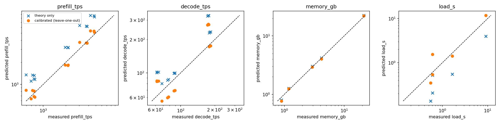

# Config-only estimates vs. measurement

Generated by `harness/compare_theory.py`. Theory: roofline from `configs/models.json` and `configs/hardware.json` (see `harness/theory.py`). Efficiency = measured / theoretical throughput (or theoretical / measured for memory and load time). *Leave-one-out*: calibrate the efficiency on the other models and predict this one from its config.

## Summary

| metric | efficiency_median | efficiency_range | theory_only_error | calibrated_loo_error | calibrated_loo_error_max |
|---|---|---|---|---|---|
| prefill_tps | 0.60 | 0.53-0.67 | 0.67 | 0.12 | 0.40 |
| decode_tps | 0.78 | 0.53-0.89 | 0.29 | 0.22 | 0.57 |
| memory_gb | 1.03 | 0.90-1.08 | 0.06 | 0.04 | 0.14 |
| load_s | 0.34 | 0.25-0.86 | 0.66 | 0.30 | 1.54 |
| decode_tps (slope + per-token overhead) | nan |  | 0.29 | 0.24 | 0.43 |

## Per model

| model | eff_prefill_tps | eff_decode_tps | eff_memory_gb | eff_load_s | loo_err_prefill_tps | loo_err_decode_tps | loo_err_memory_gb | loo_err_load_s |
|---|---|---|---|---|---|---|---|---|
| qwen3.5:0.8b | 0.55 | 0.78 | 1.08 | 0.34 | 0.12 | 0.04 | 0.06 | 0.11 |
| gemma3:1b | 0.60 | 0.53 | 0.90 | 0.25 | 0.05 | 0.56 | 0.14 | 0.37 |
| qwen3.5:2b | 0.67 | 0.88 | 1.03 | 0.86 | 0.15 | 0.21 | 0.00 | 1.54 |
| qwen3-vl:4b | 0.63 | 0.89 | 1.01 | 0.33 | 0.09 | 0.22 | 0.03 | 0.15 |
| qwen3.5:35b | 0.53 | 0.61 | 1.06 | 0.44 | 0.15 | 0.35 | 0.04 | 0.30 |

## Predictions for unmeasured models (prompt 512, output 256)

| model | prompt_tokens | output_tokens | pred_prefill_tps | pred_decode_tps | pred_memory_gb | pred_load_s |
|---|---|---|---|---|---|---|
| qwen3.8:latest | 512 | 256 | 110.63 | 12.47 | 16.65 | 8.67 |
